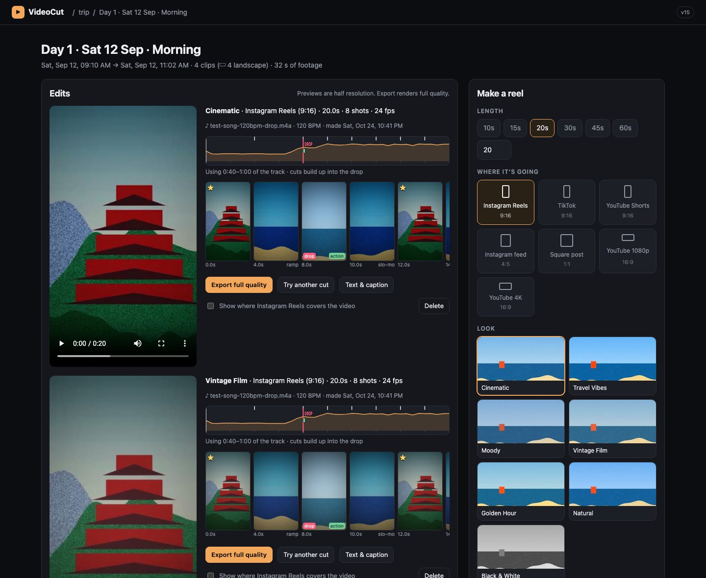
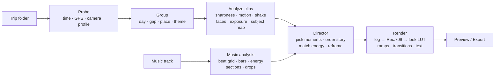
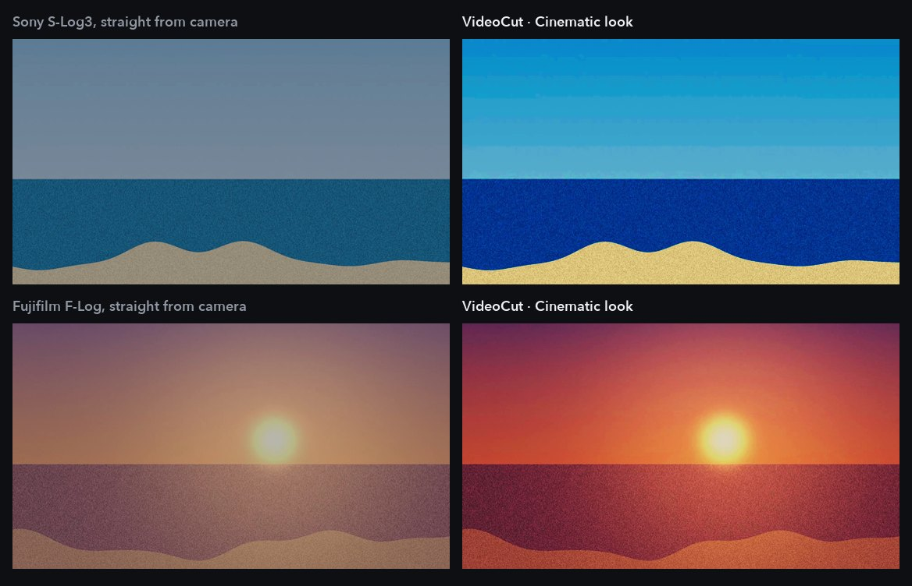
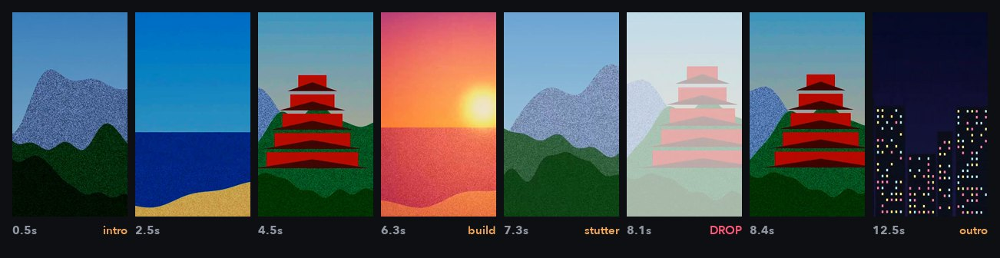
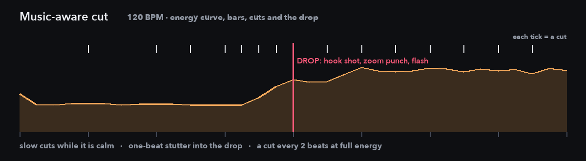

<div align="center">

# VideoCut

**Dump a trip's worth of footage into a folder. Get edited, color-graded, beat-synced reels back.**

VideoCut is a local, privacy-first auto-editor for travel video from Sony, Fujifilm and DJI cameras.
It groups your clips into stories, finds the best moments, cuts them to the structure of your music,
grades log footage, and reframes everything for Reels, TikTok, Shorts or YouTube. No timeline, no scrubbing through hours of clips.




</div>

---

## Contents

- [Highlights](#highlights)
- [How it works](#how-it-works)
- [Quick start](#quick-start)
- [Using it](#using-it)
- [Cameras and color](#cameras-and-color)
- [Music-aware cutting](#music-aware-cutting)
- [Looks and platforms](#looks-and-platforms)
- [Configuration](#configuration)
- [Privacy and cost](#privacy-and-cost)
- [Project layout](#project-layout)
- [Development](#development)
- [Limitations and roadmap](#limitations-and-roadmap)
- [License](#license)

## Highlights

| | |
|---|---|
| **Automatic story grouping** | Splits a multi-day trip by day, time gaps and GPS moves, or by theme (beaches, food, temples…) with optional Claude vision tagging. |
| **Best-moment finder** | Scores every ⅓ s of every clip for sharpness, color, motion, camera shake, exposure, faces, smiles and sound events, and skips accidental footage (ground, pocket, whip pans). ★ any clip to guarantee it a place. |
| **Action-aware cutting** | Finds the moment something happens (subject movement plus a sudden sound), shows the build-up before it, lands it on a strong beat or right on the drop, and aims the vertical crop at it. |
| **Music-aware cutting** | Detects tempo, bars, energy, sections and drops; picks the best part of the song; cuts land on the beat and the strongest shot lands on the drop. |
| **Log footage handled** | Detects S-Log2/3, F-Log/F-Log2, D-Log/D-Log M and HLG and converts with the manufacturers' published curves and gamuts. |
| **Smart reframing** | Aims each 9:16 crop at faces, moving subjects or the action, slow-pans across landscapes, blur-fills portrait clips in 16:9. |
| **Seven looks** | Cinematic teal & orange, Travel Vibes, Moody, Vintage Film, Golden Hour, Natural, Black & White, each baked into a single 3D LUT. |
| **Transitions with taste** | Hard cuts on the beat, with look-specific transitions saved for day changes, song sections and 4-bar phrases: dissolves, dips to black, motion-matched whip pans, zoom-throughs, flashes and warm light leaks. |
| **Fast previews** | Half-resolution previews render in seconds; one click exports full quality H.264. |
| **Text on video & post captions** | A place and date stamp when each day starts, your own note on any shot (emoji and flags included) styled per look and kept clear of each app's buttons, plus a ready-to-paste caption with hashtags for Reels, TikTok or Shorts. |
| **You stay in control** | Reshuffle a cut, drop a shot, hide clips, fix a misdetected profile or a sideways clip, and pause, resume or cancel any job. |

## How it works



<p align="center"></p>

## Quick start

**Requirements:** macOS (built and tested on Apple Silicon), Python 3.12, and Homebrew `ffmpeg` (7 or newer, for `xfade`) and `exiftool`. `fribidi` is optional: without it, flag emoji are left out of on-video text.

```bash
brew install ffmpeg exiftool fribidi   # fribidi: flag and joined emoji in on-video text
git clone <this-repo-url> videocut && cd videocut
python3 -m venv .venv && .venv/bin/pip install -r requirements.txt
./run.sh
```

Open **http://127.0.0.1:8430**.

Want to try it without your own footage? Generate a synthetic three-day, multi-camera trip and a test song with known drops:

```bash
.venv/bin/python scripts/make_samples.py ~/Movies/videocut-sample
.venv/bin/python scripts/make_samples.py --song music/sample-song.m4a
```

## Using it

1. **Open a trip.** Click *Choose folder…* (native macOS picker) or paste a path. Subfolders are scanned too, so dump every camera's card into one folder.
2. **Review the groups.** Adjust the time-gap slider, merge groups, rename them, or switch to *Theme (Claude)*. Merged and renamed groups survive a rescan. Hover any thumbnail to scrub it; every clip shows its orientation and aspect ratio, and ↺ ↻ fix a sideways clip.
3. **Make a reel.** Choose a length (10 to 60 s or custom), a destination, a look and optionally a track. Press *Make my edit*.
4. **Steer it (optional).** ★ the clips you care about and they're always used. Tick *Smart picks with Claude* to have Claude rate what each clip's best moments show (people, food, views vs. walls and transit).
5. **Iterate.** *Try another cut* reshuffles; ✕ on a storyboard shot drops that clip; the music map shows exactly where cuts and the drop land.
6. **Add text.** Open *Text & caption* under an edit: set the place, toggle the date, type a note on any shot and press *Update video*. *Write post caption* drafts the text and hashtags to paste when you post (Claude if an API key is set, otherwise an offline template).
7. **Export.** *Export full quality* writes to `~/Movies/VideoCut/<trip>/`. *Make reels for every group* batch-renders the whole trip.

<p align="center"></p>

## Cameras and color

| Source | What VideoCut reads |
|---|---|
| **Sony** (XAVC S / HS) | Capture time with timezone, GPS, S-Log2 / S-Log3 / HLG from embedded metadata |
| **Fujifilm** (MOV) | Capture time, F-Log / F-Log2 |
| **DJI drones, Osmo, Pocket** | Local time from file names, GPS and color mode from `.SRT` sidecars, `.LRF` proxies for faster analysis, aerial detection |
| **Anything else** | QuickTime / EXIF dates and GPS, rotation, frame rate, HDR transfer tags |

Log conversion uses the published transfer functions and gamut primaries (S-Gamut3.Cine, S-Gamut, F-Gamut / Rec.2020, D-Gamut), followed by a filmic tone map and per-clip auto exposure (night scenes are kept dark). For an exact manufacturer match, or for D-Log M, which has no published curve, drop the official `.cube` into `luts/` named after the profile:

`slog3.cube` · `slog2.cube` · `flog.cube` · `flog2.cube` · `dlog.cube` · `dlogm.cube` · `hlg.cube`

If a profile is misdetected, change it per clip in the UI; thumbnails and analysis update automatically.

## Music-aware cutting

<p align="center"></p>

When a track is selected, VideoCut:

- **Locks a beat grid** by fitting a constant-tempo grid to kick-drum onsets (the plain DP beat tracker drifts on long tracks), falling back to tracked beats for live or variable-tempo music.
- **Finds bars, energy, sections and drops.** A drop is a sustained loudness jump of more than 4 dB at a section change, so flat songs don't get fake drops.
- **Picks the best excerpt** for your length: a short build-up, the drop roughly a third of the way in, starting and ending on bar lines. *From the start* is available too.
- **Plans the cuts.** Longer shots in calm parts, shorter ones as energy rises, one-beat stutter cuts into the drop (Travel Vibes), and always a hard cut on the drop and at section changes.
- **Arranges shots to the music.** The most eye-catching shot goes on the drop and a hook opens the reel; the rest stay in story order with calm shots matched to quiet passages and action to loud ones.
- **Adds drop effects.** A speed ramp decelerating into the drop, a zoom punch and an optional white flash.

Only use music you have the rights to publish.

## Looks and platforms

| Look | Character | fps | Extras |
|---|---|---|---|
| **Cinematic** | Teal & orange, soft contrast | 24 | Widescreen bars (16:9), grain, vignette, slow-mo; dissolves, dips to black, motion-matched whip pans |
| **Travel Vibes** | Punchy, bright, warm | 30 | Fast cuts, motion-blurred whip pans, zoom-throughs, white flashes, punch on drops |
| **Moody** | Dark, desaturated, cool shadows | 24 | Faded blacks, strong vignette; slow dissolves, dips to black |
| **Vintage Film** | Warm faded stock | 24 | Heavy grain, glow; light-leak dissolves |
| **Golden Hour** | Sun-kissed warmth | 24 | Glow; light-leak dissolves |
| **Natural** | True to life | 30 | Mostly cuts, gentle dissolves |
| **Black & White** | High-contrast monochrome | 24 | Grain; greyscale dissolves, dips to black |

| Destination | Resolution |
|---|---|
| Instagram Reels | 1080 × 1920 (9:16) |
| TikTok | 1080 × 1920 (9:16) |
| YouTube Shorts | 1080 × 1920 (9:16) |
| Instagram feed | 1080 × 1350 (4:5) |
| Square | 1080 × 1080 |
| YouTube | 1920 × 1080 or 3840 × 2160 |

Hard cuts land on the beat; transitions are saved for meaningful moments (day changes, section changes, every 4-bar phrase), whip pans follow the camera's own movement, and the drop is always a hard cut. Vertical previews can overlay the areas each app covers with its own buttons and captions, so nothing important sits underneath.

## Configuration

| Variable | Default | Purpose |
|---|---|---|
| `PORT` | `8430` | Server port (`run.sh`) |
| `VIDEOCUT_DATA` | `./data` | Caches, thumbnails, previews (safe to delete) |
| `VIDEOCUT_EXPORTS` | `~/Movies/VideoCut` | Full-quality exports |
| `VIDEOCUT_MUSIC` | `./music` | Music library |
| `ANTHROPIC_API_KEY` | — | Enables the optional Claude features: themes, Smart picks, post captions |
| `VIDEOCUT_MODEL` | `claude-opus-5-5` | Model used for the Claude features |

## Privacy and cost

- **Everything runs locally.** Probing, analysis, music analysis, grading and rendering use ffmpeg, OpenCV and librosa on your machine. Footage never leaves it.
- **Optional cloud features.** *Smart picks* sends three small frames per clip once (cached), about 1–2¢ per clip. *Write post caption* sends the edit's text (place, dates, your notes, clip descriptions) to Claude when a key is set; without one it uses an offline template. *Find themes with Claude* sends one small 2×2 contact sheet per clip plus clip metadata (time, GPS, camera) to the Anthropic API, and only when you press the button. Tags are cached, so re-running only processes new clips. A 100+ clip trip costs well under a dollar.
- **Your data stays out of git.** `data/`, `music/` and `luts/` are git-ignored.

## Project layout

```
backend/
  main.py       FastAPI app, jobs and API
  media.py      probing: time, GPS, camera, rotation, color profile
  grouping.py   day / gap / place grouping
  analysis.py   per-clip frame scoring and subject maps
  music.py      beat grid, bars, energy, sections, drops, excerpt, cut slots
  director.py   shot selection, story order, energy matching, reframing, effects
  looks.py      color science and LUT baking
  render.py     ffmpeg segment rendering and assembly
  text.py       on-video notes and place/date stamps (per-look styles, app-safe placement, emoji)
  caption.py    post caption and hashtags (Claude or offline template)
  ai.py         optional Claude scene tagging and theme grouping
  control.py    pause / resume / cancel for every subprocess a job starts
  store.py      projects and background jobs
frontend/       plain HTML, CSS and JS (no build step)
scripts/        synthetic sample trip and test-song generator
tests/          pytest suite
```

## Development

```bash
.venv/bin/python -m pytest -q
```

The suite covers grouping and rescans, log transfer functions, gamut math, looks, shot planning (starred clips, action placement, fewer shots for small groups, accidental-footage penalties), music analysis (tempo, downbeats and drops on a synthetic song with known structure), excerpt choice, text timing, template captions and rotation handling. The version label in the top bar comes from the `?v=` tag on `app.js` in `frontend/index.html`; bump it when you change the frontend and open windows will offer a reload.

## Limitations and roadmap

**Current limitations**

- macOS-first: the folder picker and *Show in Finder* use macOS tools; the rest is portable.
- Drop detection shines on pop, EDM and house; ambient and acoustic tracks get energy-paced cuts without drop effects.
- Reframing picks one crop or a smooth pan per shot rather than tracking the subject frame by frame, so very fast sideways action can leave a 9:16 frame (the peak moment is kept in frame).
- Without Smart picks, VideoCut judges how moments look and move, not what they mean.

**Roadmap**

- [ ] Manual timeline: trim, reorder and swap takes
- [ ] Auto captions from speech
- [ ] Stabilization for handheld shots
- [ ] Per-frame subject tracking for vertical reframes
- [ ] Music ducking under speech, transition sound effects
- [ ] Map route animations from GPS

## License

[MIT](LICENSE). Use it, change it and share it; keep the license notice.

## Acknowledgements

Built on [FFmpeg](https://ffmpeg.org), [OpenCV](https://opencv.org), [librosa](https://librosa.org), [FastAPI](https://fastapi.tiangolo.com), [NumPy](https://numpy.org), [Pillow](https://python-pillow.org) and [ExifTool](https://exiftool.org).
